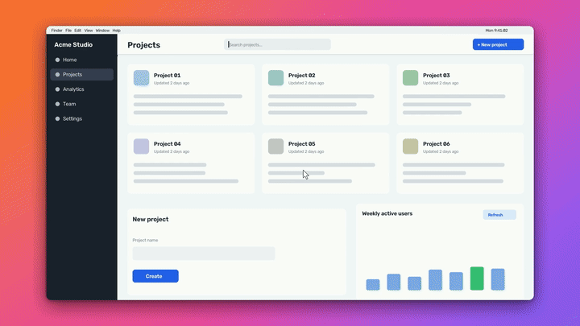
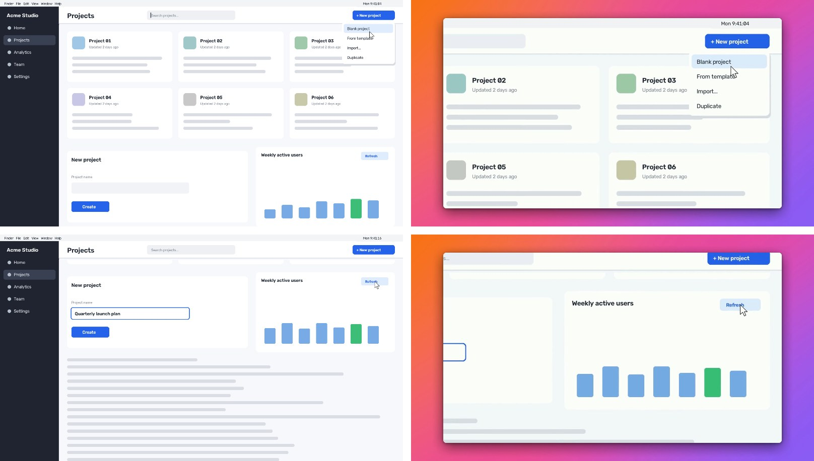
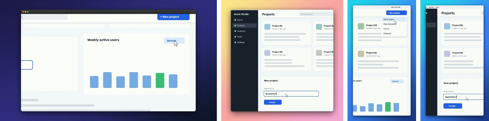
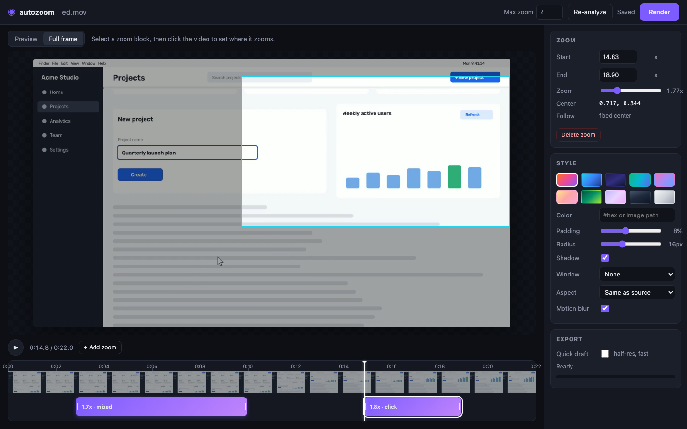

# autozoom

**A free, local Screen Studio alternative for any screen recording.**
Smooth automatic zooms on where the action is, a gradient background with padding, rounded corners, a soft drop shadow and an optional macOS window frame. One command, no account, no upload. Pure Python + a bundled ffmpeg, so it should run anywhere Python does (developed and tested on macOS so far).

```bash
autozoom demo.mov            # -> demo.autozoom.mp4
```



## Before / after

Left: the raw recording. Right: what `autozoom demo.mov` produced, with no manual edits.



Other styles from the same recording: `--background midnight --frame dark`, `--aspect 1:1 --background peach`, and `--aspect 9:16 --background ocean`. In 9:16 the crop follows the action.



> These images come from the synthetic recording made by [`examples/make_demo.py`](examples/make_demo.py), so you can reproduce them yourself (see [Reproduce the demo](#reproduce-the-demo)).

## Install

Python 3.9+ is the only requirement. ffmpeg ships inside the `imageio-ffmpeg` wheel, so you don't need a system ffmpeg.

```bash
git clone https://github.com/thecidsama/autozoom && cd autozoom
python -m venv .venv && source .venv/bin/activate     # Windows: .venv\Scripts\activate
pip install -e .
```

Dependencies: `numpy`, `opencv-python-headless`, `imageio-ffmpeg`. Nothing else.

## Quickstart

```bash
autozoom recording.mov                                # auto zoom + default "sunset" style
autozoom recording.mov -o out.mp4 --zoom 1.8          # gentler maximum zoom
autozoom recording.mov --background ocean --padding 6% --radius 20
autozoom recording.mov --background "#0f172a" --frame dark
autozoom recording.mov --background wallpaper.jpg --no-shadow
autozoom recording.mov --aspect 9:16                  # vertical, the crop follows the action
autozoom recording.mov --preview                      # fast half-res draft -> recording.preview.mp4
autozoom recording.mov --no-zoom                      # just the frame/background, no zooms

# hand-tune the zooms:
autozoom recording.mov --save-plan plan.json --analyze-only
$EDITOR plan.json
autozoom recording.mov --plan plan.json

# or tune them visually:
autozoom edit recording.mov
```

| Option | Default | |
|---|---|---|
| `-o, --output` | `<input>.autozoom.mp4` | output file |
| `--zoom` | `2.0` | maximum zoom |
| `--background, -b` | `sunset` | `sunset`, `ocean`, `midnight`, `aurora`, `candy`, `peach`, `forest`, `lavender`, `slate`, `mono`, a `#hex` color, or an image path |
| `--padding` | `8%` | space around the video, as a % of the short side or in px |
| `--radius` | `16` | corner radius in px at 1080p (scales with output size) |
| `--shadow / --no-shadow` | on | soft drop shadow |
| `--frame` | `none` | `light` / `dark` macOS-style title bar |
| `--aspect` | `source` | `source`, `16:9`, `4:3`, `1:1`, `4:5`, `9:16` |
| `--fit` | `auto` | `fit` shows the whole recording, `crop` crops to the output aspect and follows the action. `auto` crops when the aspects differ a lot, as with 9:16 |
| `--plan / --save-plan` | | load or write the zoom plan JSON |
| `--fps` | source fps | output frame rate |
| `--size` | | exact output size, e.g. `1920x1080` |
| `--motion-blur / --no-motion-blur` | on | light blur during fast camera moves |
| `--crf`, `--preset` | `18`, `medium` | x264 quality and speed |
| `--preview` | | half resolution, `ultrafast`, no motion blur |

The output is H.264 MP4 (yuv420p, BT.709, `+faststart`). The original audio is stream-copied when the MP4 container supports its codec (AAC, MP3, AC-3, ALAC) and re-encoded to AAC otherwise. Frames stream through pipes, so memory use stays flat no matter how long the recording is.

## How auto-zoom decides

autozoom only has the pixels. It never sees your mouse clicks or keystrokes. It works on a downscaled grayscale copy (640 px wide, 15 fps):

1. **Change detection.** Each frame is diffed against the previous one, with a blur and a threshold to ignore compression noise. The result is dilated so letters merge into word-sized blobs.
2. **Full-screen changes are never zoomed.** If a large share of the screen changes at once (a scroll, page load or app switch), that moment is marked *global*. Any zoom in progress ends there, and nothing near it can start a zoom.
3. **Cursor tracking.** A moving pointer leaves a pair of cursor-sized blobs: the spot it left and the spot it moved to. A small-blob tracker uses that pattern to follow the pointer and learns its size. Pointer blobs are removed from the activity signal, so moving the mouse around does not trigger zooms.
4. **Flicker filtering.** autozoom ignores tiny components and blobs that keep reappearing in the same place: blinking carets, ticking clocks, spinners. A group of changes only counts if it leaves a *lasting* change. A pointer or hover passing over something does not count.
5. **Events.** A *click-like* event is a localized change, such as a button state, menu or focus ring, that appears within about 0.9 s after the cursor stops near it. *Typing* is a fast burst of small changes along one line.
6. **Zoom plan.** Events are clustered in space and time. Each cluster gets:
   - a zoom level from the extent of its activity, capped at `--zoom`
   - a center path that follows the action when it moves
   - a 0.5 s lead-in, a 1.1 s tail and a 1.6 s minimum hold

   Clusters whose activity is spread too wide (less than 1.25x) are skipped. If two zooms are less than about 1 s apart, they merge, and the camera pans between them instead of zooming out and back in.
7. **Camera.** Center x, center y and log-zoom each run through a critically-damped spring that is integrated exactly per frame. Moves start gently, never overshoot and settle without jitter. The view is then clamped inside the frame, so warping never shows black edges. Fast moves get a short, capped motion blur.

## The plan file

`--save-plan` writes plain JSON. Coordinates are normalized to 0..1 of the source frame, and times are in seconds:

```json
{
  "version": 1,
  "duration": 22.0,
  "max_zoom": 2.0,
  "segments": [
    { "start": 2.83, "end": 9.97, "zoom": 1.82, "center_x": 0.92, "center_y": 0.15, "kind": "mixed",
      "path": [[2.83, 0.92, 0.15], [5.4, 0.92, 0.15], [8.87, 0.25, 0.83], [9.97, 0.25, 0.83]] },
    { "start": 15.23, "end": 19.1, "zoom": 1.77, "center_x": 0.82, "center_y": 0.33, "kind": "click" }
  ],
  "focus": [[0.0, 0.5, 0.5], [0.25, 0.5, 0.5]]
}
```

- `zoom` is relative to the full frame (2.0 shows half the width).
- `path` is optional: `[time, x, y]` keyframes the camera follows inside the segment. Delete it to use the fixed `center_x/center_y`.
- `kind` is informational only (`click`, `typing`, `activity`, `mixed`, `manual`).
- `focus` is optional. It is the point of attention between zooms, which crop layouts such as 9:16 follow.
- You can also pass a bare list of segments. Overlapping segments are trimmed automatically.

## The editor

```bash
autozoom edit recording.mov       # opens http://127.0.0.1:8765/
```



The editor runs on a small local web server (Python stdlib, vanilla HTML/JS, no extra dependencies, bound to 127.0.0.1).

- **Timeline.** The zooms show as blocks over a filmstrip. Drag a block to move it and drag its edges to resize it. Double-click the track or press `Z` to add a zoom. Press `Delete` to remove the selected one.
- **Set the target.** Select a block, then click the video where it should zoom.
- **Preview and Full frame.** Preview is a live approximation of the final render. It ports the same layout and spring camera to JS, using CSS transforms. Full frame shows the whole recording with the zoom rectangle on top.
- **Style panel.** Background presets, color/image, padding, radius, shadow, window frame, aspect and motion blur.
- **Render.** Runs the real renderer with a progress bar, fps and ETA. Tick *Quick draft* for a fast half-res render.

Edits are auto-saved to `recording.autozoom.json`, which also works with `--plan`. The browser plays a 720p H.264 proxy that is generated on start in a temporary folder and deleted when the editor stops.

## Performance

On an Apple Silicon laptop (10 cores), a 22 s 1920x1080 30 fps clip took 0.3 s to analyze and about 4-5 s to render, i.e. roughly 135-165 fps with libx264 `medium`, CRF 18 and motion blur on. A half-res `--preview` ran at about 770 fps. Speed depends mostly on output resolution and the x264 preset.

## autozoom vs Screen Studio

| | Screen Studio | autozoom |
|---|---|---|
| Price | Paid | Free, MIT |
| Platforms | macOS only | Cross-platform Python (tested on macOS; Linux/Windows untested but no platform-specific code) |
| Input | Records your screen itself | Any existing recording (mov, mp4, webm, mkv, ...) from any recorder |
| Where zooms come from | Real click and cursor data captured during recording | Inferred from pixel changes |
| Cursor | Can restyle and smooth the real cursor | Leaves the cursor as recorded |
| Editing | Polished native app | Plan JSON + a small local web editor |
| Privacy | Local app | Local, nothing is uploaded |

Be aware: because autozoom infers activity from pixels, **it is less precise than real click data.** It can miss a click that changes nothing on screen, and it can zoom on an animation you didn't care about. The editor and the plan file are there so you can fix that in a few seconds.

## Limitations

- No access to real input events. Clicks with no visible reaction are invisible to it, and the cursor tracker can lose the pointer on busy screens or after a scroll (it re-acquires on the next clear move).
- The cursor is not replaced or smoothed. Recordings without a visible cursor still work, using activity only.
- Videos that play inside the recording, or large animated regions, can attract zooms or block them (big changes count as "global").
- The editor preview approximates the render (CSS gradient vs. the rendered gradient, no motion blur). Image backgrounds show as a placeholder in the preview.
- The browser must be able to play H.264 MP4. Every mainstream browser can, but some open-source Chromium builds cannot.
- So far it has been tested mainly on synthetic recordings (see below). Please report recordings where it guesses badly.

## Reproduce the demo

```bash
python examples/make_demo.py demo.mov                   # 1920x1080 30 fps with audio, ~2 s to generate
python examples/make_demo.py idle.mov --scenario idle   # only a blinking caret, a clock and a wandering cursor: should produce no zooms
autozoom demo.mov
```

`make_demo.py` draws a fake desktop app and scripts: an idle period, a cursor gliding to a button, a click that opens a menu, typing into a form, a full-screen scroll, and a chart that animates after a click. Pass `--size 2560x1440 --fps 60` for a bigger test.

## Development

```bash
pip install -e ".[test]"
pytest            # 22 tests, ~4 s: plan generation on synthetic videos, spring camera, end-to-end renders
```

Layout: `autozoom/analyze.py` (activity to zoom plan), `camera.py` (spring camera), `style.py` (backgrounds, layout, corners, shadow, frame), `render.py` (streaming renderer), `media.py` (ffmpeg pipes), `plan.py` (plan JSON), `editor/` (web editor), `cli.py`.

## License

MIT. See [LICENSE](LICENSE). "Screen Studio" is a trademark of its owner. autozoom is not affiliated with it.
